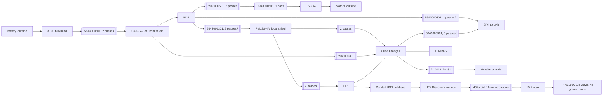

# Ferrite and EMI Design Record — NAU VHF Drone

Written 2026-11-09 from one Claude chat session with Michael Shafer. Revised the same day after
reading `hardware/README.md`, `hardware/NAU_VHF_DRONE.md` and Don Gagne's
`MavlinkTagController2/docs/hardware/PDC_VHF_DRONE.md`.

Moved into `hardware/` on 2026-11-10 from `_baseline/ferrite_report.md`, which stays as the
original. Changes made when moving it:
- Every row of the ferrite table now has a label, F1 to F13, because the reasoning in section 2.3
  refers to rows by those labels and the original never assigned them.
- Section 2.3, F1: the 100 A full-throttle figure belongs to this aircraft's battery lead. The
  original attributed it to Don's aircraft.
- Section 5: added the capture method and test frequency used for the first in-flight noise run,
  and a caution about bench runs with the props off.
- Every **[DON]** figure was checked against Don's page as of 2026-11-09 and matches it.

The short version of this design is in the Shielding and Ferrites sections of
`NAU_VHF_DRONE.md`. This file keeps the reasoning, the rejected options, the test plan and the
theory.

**No before/after measurements have been taken on this aircraft.** This is a record of the design,
the decisions and the reasons for them. Every row is *not yet measured* until the A/B test in
Section 5 is run.

## How to read this record

Every claim carries a tag:

| Tag | Meaning |
|---|---|
| **[DS]** | Manufacturer datasheet or manufacturer product page (named) |
| **[DIST]** | Distributor listing (DigiKey, RS, TME and so on); not checked against the datasheet |
| **[DON]** | Don Gagne's measured result on his aircraft, from `PDC_VHF_DRONE.md` (date given) |
| **[USER]** | Stated by Michael about this aircraft |
| **[OBS]** | Michael's informal past observation; not a controlled measurement |
| **[EST]** | This session's numeric estimate (method stated) |
| **[REASON]** | This session's engineering reasoning or general practice |
| **[UNKNOWN]** | Not known; do not fill in by guessing |

Shorthand used below:
- **Common-mode current:** the net current on a cable (all conductors together), which radiates and which a ferrite blocks.
- **Pass:** one trip of the wire through the core's hole.
- **SDR:** software-defined radio, here the receiver.
- **BEC:** battery eliminator circuit, a switching regulator that makes 5 V from the battery.
- **PDB:** power distribution board.
- **λ:** wavelength, about 2 m at 150 MHz.

Toroid impedances are estimates. Fair-Rite publishes inductance factors for toroids, not
impedance curves.

---

## 1. Aircraft facts learned in this session

These fill blanks on `NAU_VHF_DRONE.md`. All **[USER]** unless marked.

### SDR and antenna
- **Receiver:** Airspy HF+ Discovery, mounted on the aircraft **outside** the vehicle shield. It replaced an Airspy Mini, a wideband receiver without the HF+'s front-end rejection.
- **USB path:** Pi 5 inside the shield → USB-A extension → USB bulkhead in the shield → the HF+'s own USB cable (factory molded ferrites near both ends) → HF+.
- **Coax:** RG-316, 15 ft (about 4.6 m) from the HF+ down to the antenna **[USER]**. Typical RG-316 jacket diameter is about 2.5 mm **[REASON, typical spec; measure to confirm]**.
- **Antenna:** Larsen (now Pulse Electronics) **PHW150C**, hanging below the aircraft on the coax, with **no ground plane**.
  - Listed as a 1/2-wave, 144–174 MHz, 2.4 dB "portable half wave" base coil plus field-tunable whip **[DIST: Talley/Larsen catalog sheet; ArcAntenna]**.
  - One retailer (GigaParts) calls it a 5/8-wave; the Larsen catalog sheet says 1/2 λ. Treat it as 1/2 λ **[DIST, conflict noted]**.
  - `NAU_VHF_DRONE.md` says the project's omni monopole hangs about 5 m below the aircraft. The 15 ft coax is consistent with that. Strictly, the PHW150C is an end-fed half-wave rather than a monopole; the project's documents call it the omni or the monopole.
- **Coax choke:** at the HF+ RF input (not at the antenna). **Fair-Rite 5943002701** (FT-140 size), 38 g. Identified 2026-11-10 from Michael's measurements, OD ≈ 35 mm, ID ≈ 22.7 mm, height ≈ 12.8 mm; see Section 2.4. Mix 43: Michael knows it is 43 or 44, and the dimensions rule out 44. Wound with 12 turns of coax as a **crossover winding**, 6 per side, same rotational sense on both halves, verified from Michael's sketch.

### Shielding and airframe
- **Vehicle shield:** custom-fitted Titan RF fabric cover over the fuselage and motor arms; partly covers the ESCs. Outside the shield: motors (on top of it), battery, GPS unit, SIYI antennas, the HF+.
- **XT90 bulkhead** where the battery leads enter.
- **USB bulkhead:** back shell bonded all the way around to the vehicle shield with Titan conductive tape. Continuity checked from the HF+ antenna-port back shell to the vehicle shield.
- Quad, 4 ESCs mounted at the motors at the arm tips. ESC input: DC pair (12 AWG) plus a PWM signal. **ESC signal ground wires removed**, cut at both ends. Motor phase wires run inside the shield to the motors.
- **ESCs:** Hobbywing **XRotor PRO 50A** (wire-leaded) **[USER]**. 50 A continuous, 100 A peak; 4–6S input; no BEC; 48 × 30 × 15.5 mm, 56 g; Hobbywing SKU 30902010 **[DS: Hobbywing North America product page]**. Each has two large capacitors on the DC input side, most likely the input capacitors; their values are **[UNKNOWN]** **[USER observation]**. For comparison, Don's ESCs each have one 330 µF 35 V **[DON]**.

### Power
- **Power monitor:** Matek **CAN-L4-BM**, on battery + only, with a JST-GH 4-pin CAN lead to the Cube.
  - INA239 current/voltage sensor and an STM32L431 microcontroller running ArduPilot AP_Periph firmware **[DS: Matek]**.
  - Powered at 4.5–5.5 V through its 5 V pin (from the CAN lead), drawing 10 mA **[DS: Matek]**.
  - Current path 200 µΩ typical; 150 A continuous, 204.8 A burst **[DS: Matek]**.
  - Board 30 × 22 × 3 mm, 4 g **[DS: Matek]**.
  - The big pad on the bottom is a dead pad with no circuit connection **[DS: Matek]**. The shield strap is on a proper GND pad (small corner pad next to the CAN ground pin) **[USER, confirmed]**.
  - Don's aircraft uses the same module **[DON]**.
- **Dual BEC:** Matek **PM12S-4A**, both outputs at 5 V **[USER]**.
  - Input 9–55 V with TVS protection **[DS: Matek]**.
  - OUT-1 selectable 5/6/7.2/12 V (5 V default), PWM-switchable, default ON. OUT-2 fixed 5 V. Each 4 A continuous, 5 A peak **[DS: Matek]**.
  - Ripple 20 mV (50 V in, 5 V at 4 A) **[DS: Matek]**. This says nothing about 150 MHz noise **[REASON]**.
  - 50 × 32 × 7 mm, 18 g **[DS: Matek]**.
  - **OUT-2 (fixed 5 V) powers the Pi 5** **[USER]**, so the PM12S-4A is the **Pi 5's supply**. OUT-1 (set to 5 V) powers the Cube Orange+ **[USER, by elimination: both outputs feed only the Cube and the Pi 5]**.
- **History:** previously a Castle Creations CC BEC 2.0, replaced after the Cumbria fieldwork (November 2025). A colleague reported the Matek UBEC DUO, now discontinued, was quieter in this band. Matek lists the PM12S-4A as its successor. Don's aircraft flies the UBEC DUO **[DON]**.
- **PDB** feeds the 4 ESCs, the SIYI air unit directly, and the PM12S-4A.

### Avionics
- Cube Orange+. Pi 5 to Cube serial link deliberately short, **3–4 cm** (TELEM2 at 921600 baud per `NAU_VHF_DRONE.md`).
- SIYI air unit: UART and S.Bus to the Cube; powered from the PDB.
- Benewake TFMini-S lidar: GND, 5 V, TX, RX; powered from the Cube serial port. **Inside the shield**, pointing down through the belly pan, with a port cut in the shield over its optics **[USER, 2026-11-10]**. Its cable therefore never crosses the shield.
- **GPS:** CubePilot Here3+ on CAN 1. Unit outside the shield, forward of the fuselage between arms 1 and 3, level with the fuselage top surface (no mast). Cable runs inside the shield. Sits close to the fuselage ferrites for arms 1 and 3.

### Test equipment on hand
NanoVNA, R-1000 handheld analog receiver (used as a near-field sniffer), HF+ Discovery.

### Photos
None yet.

---

## 2. Ferrite and shielding decisions

**Material.** All cores are Fair-Rite **mix 43**.
- Fair-Rite recommends 43 for suppression from about 20 to 250 MHz, µi ≈ 800 **[DS: Fair-Rite]**.
- Mix 44 targets about 30 to 500 MHz with lower peak impedance in our band **[DS: Fair-Rite + REASON]**.
- Don also uses mix 43 for 146 MHz **[DON]**.

**Rules applied to every core [REASON, general EMC practice]:**
- **All conductors together.** Every conductor of a cable or pair, including the return, goes through the same core. Load current and signals cancel, so the core sees only common-mode noise and can't saturate on DC. CAN, UART, S.Bus, PWM and USB data are unaffected.
- **Passes.** Ideally impedance rises with passes squared. At 150 MHz, capacitance between turns cuts that to about 2–3× for 2 passes.
- **Shield exits.** Where a cable leaves a shield, the core sits just outside the exit, so nothing inside can couple onto the wire beyond it.
- **Nearby cores are fine.** Toroids keep their flux inside the ring, so neighboring cores don't interact.

### 2.1 Table in the format of `NAU_VHF_DRONE.md`

F1 to F13 are labels for the rows of this table; section 2.3 refers to them.

| ID | Location | Part | Turns | Status | Why it is there | Measured effect |
| --- | --- | --- | --- | --- | --- | --- |
| F1 | Main battery leads (+ and −) inside the shield, ~1 cm from the XT90 bulkhead | Fair-Rite 5943000501 (43 toroid) | 2 | Fitted | Stops noise from inside the shield leaving on the battery leads. See 2.3 F1 | Not yet measured |
| F2 | Each ESC input (DC+, DC−, PWM), in fuselage at the arm exit, ×4 | Fair-Rite 5943000501 | 2 | Fitted | Common-mode noise from ESC switching. Don fits cores at the same spot **[DON]** | Not yet measured |
| F3 | Each ESC input, at the ESC end of the arm, ×4 | Fair-Rite 5943000501 | 1 | Fitted; keep or remove after test | Stops noise before the arm wiring radiates it. Costs ~12 g at each arm tip | Not yet measured |
| F4 | PM12S-4A input pair | Fair-Rite 5943000301 (43 toroid) **[USER]** | 2 **[USER: "I think"; confirm]** | Fitted | Switching-regulator noise. Follows Don's UBEC DUO treatment **[DON]** | Not yet measured |
| F5 | PM12S-4A output pairs (OUT-1 to Cube; OUT-2 to Pi 5) | Fair-Rite 5943000301 **[USER]** | 2 each **[USER: "I think"; confirm]** | Fitted | As above. Don: output-pair cores took 4 dB off the floor **[DON 2026-09-20]** | Not yet measured |
| F6 | SIYI power lead from PDB | Fair-Rite 5943000301 **[USER]** | 2 **[USER: "I think"; confirm]** | Fitted | SIYI air unit as a source | Not yet measured |
| F7 | SIYI UART + S.Bus, one shared core | Fair-Rite 5943000301 (43 toroid) | 3 | Fitted | Both cables run between the same two devices, so sharing is safe | Not yet measured |
| F8 | CAN-L4-BM CAN lead to Cube, just outside its local shield | Fair-Rite 5943000301 (43 toroid) **[USER]** | 2 **[USER]** | Fitted | Don: this lead left disconnected and un-ferrited raised his floor 12 dB **[DON 2026-09-19]** | Not yet measured |
| F9 | Here3+ GPS CAN 1 cable at the shield exit, all 4 conductors | 2 × Fair-Rite 0443178181, stacked | 1 each | Fitted | Unshielded cable crossing the vehicle shield; a core is the only boundary filter | Not yet measured |
| F11 | HF+ USB cable, outside segment | Factory molded ferrites now. **Recommended:** 2 × Fair-Rite 0443164251 at the HF+ end, 2 turns each | 2 | Factory fitted; Fair-Rite cores **recommended, not fitted** | Don's strongest result: USB cores cut regulator humps 9 → 3 → ~2 dB **[DON 2026-09-20]** | Not yet measured |
| F12 | Pi 5 → bulkhead USB extension, inside segment | **Recommended:** 1 × Fair-Rite 0443164251, 2 turns, at the Pi end | 2 | Recommended, not fitted | Don: one 2-turn core at the Pi end removed the last ~2 dB **[DON 2026-09-20]** | Not yet measured |
| F10 | Coax at HF+ RF input | Fair-Rite 5943002701 (FT-140 size), mix 43; see 2.4 | 12 (crossover, 6 + 6) | Fitted; under review | Blocks drone common-mode current from entering the 15 ft coax. ~8 dB on the Airspy Mini **[OBS]** | Not yet measured |
| F13 | Coax near the antenna feed | Not chosen yet (Section 2.3, F13) | — | Proposed | Hanging vertical coax is in line with the whip; see F13 | Not yet measured |
| — | TFMini-S serial | None | — | Decided: not fitted | Low-priority source; its cable stays inside the shield **[USER, 2026-11-10]** | Not yet measured |
| — | Pi 5 ↔ Cube serial (3–4 cm) | None | — | Decided: not fitted | Too short to radiate at 150 MHz | — |
| — | Motor phase wires | None | — | Rejected | Don: a 43 clip-on on the phase wires made 0 dB difference **[DON 2026-09-21]** | — |

**Shielding** (format of Don's Shielding table):

| What | How | Status | Notes |
| --- | --- | --- | --- |
| Vehicle | Custom-fitted Titan RF fabric over fuselage and arms | Fitted | Not yet measured. Don's comparable avionics-box wrap: 7.4 dB **[DON 2026-09-19]** |
| USB bulkhead | Back shell bonded all the way around to the vehicle shield with Titan tape | Fitted, continuity checked | Not yet measured |
| CAN-L4-BM | Kapton, then Titan RF tape; 1.5 cm copper solder-wick strap to a GND pad (not the dead pad) | Fitted, grounding confirmed by Michael | Grounded to its own GND, not to the vehicle shield |
| PM12S-4A | Kapton, then Titan RF tape; solder-wick strap to the module's ground | Fitted | Follows Don's UBEC DUO wrap. Don: DUO raised his floor +11 dB bare, +3 dB in his box **[DON 2026-09-19]** |
| Battery leads at the bulkhead: capacitors to shield | 1–10 nF ceramic, rated ≥ 2× pack voltage | Deferred | Safety: a failed capacitor on + shorts the pack |

### 2.2 Part data

| Part | Type | Size (mm) | Weight | Impedance | Source |
|---|---|---|---|---|---|
| 5943000301 | 43 toroid | 12.7 × 7.15 × 4.9 (OD × ID × H) | ~2 g | Est. ~30 Ω at 150 MHz for 1 pass; ~60–90 Ω for 2 passes; ~120–180 Ω for 3 passes | Size and weight **[DIST]**; Z **[EST]** |
| 5943000501 | 43 toroid | 21 × 13.2 × 11.9 | 12 g | Est. ~58 Ω for 1 pass; ~115–175 Ω for 2 passes | **[DIST]**; Z **[EST]** |
| 5943001001 | 43 toroid | 29 × 19 × 7.5 | ~13 g | Est. ~34 Ω for 1 pass; ~70–100 Ω for 2 passes | Size **[DIST: DigiKey, RS]**; weight **[EST]** |
| 0443164251 | 43 snap-on | 18.0 OD × 32.3 long; 6.30 mm minimum bore | 31 g | 263 Ω at 100 MHz, 311 Ω at 250 MHz (1 pass) | **[DS: Fair-Rite]**. DigiKey lists 6.6 mm bore **[DIST]**; Don quotes 6.6 mm bore, 32 mm long |
| 0443178181 | 43 snap-on | 11.50 ± 1.5 OD, 4.10 minimum bore, 23.00 ± 1.5 long | **[UNKNOWN]** | 100 Ω minimum at 100 MHz (1 pass) | Size **[DS: Fair-Rite 0443178181cat.pdf]**; impedance **[DS, cited by Michael from the same sheet]**. DigiKey lists 125 Ω, likely typical |

**Toroid estimate method [EST].** Single-pass impedance scaled by the geometry factor
height × ln(OD/ID) from the 2643101902 cable core's datasheet value (204 Ω at 100 MHz,
about 220 Ω at 150 MHz interpolated). Multi-pass values assume 2–3× for 2 passes and 4–6× for
3 passes. Use these to rank cores, not as absolute values; confirm with a NanoVNA sweep.

### 2.3 Reasoning for each decision

**F1 — Battery leads.**
- **Target:** common-mode noise from everything inside the shield leaving on the battery leads to the battery and leads outside, where it radiates **[REASON]**.
- **Both leads together:** battery current is tens of amps; a core on one lead would saturate **[REASON]**. This aircraft's battery lead carries about 100 A at full throttle **[from `NAU_VHF_DRONE.md`, MAD's figure]**.
- **Placement:** 1 cm from the bulkhead is about λ/200, too short to pick up much **[REASON]**.
- **Battery negative not bonded to the shield:** the shield is already tied to system ground through the USB bulkhead. A second bond would put battery and ESC ripple current on the shield **[REASON]**.

**F2/F3 — ESC inputs.**
- **Why:** the ESCs are the highest-current, fastest-switching source **[REASON]**. Don found his in-flight floor is set by the ESCs' PWM chopping at hover duty **[DON 2026-09-21]**. The arm wiring is near λ/4 (~50 cm), an efficient radiator **[REASON]**.
- **Two placements:** F3 at the ESC stops noise at the source; F2 in the fuselage catches anything the arm picks up. Cores in series add **[REASON]**.
- **PWM signal:** its ground wire was cut. It returns on DC−, which goes through the same core, so the signal cancels in the core **[REASON]**.
- **Why the signal ground was cut:** it was disconnected at the Cube to break a ground loop, which left a wire connected at the ESC end only. That is an antenna driven by ESC ground noise, so it was cut at the ESC too **[REASON]**.
- **F3 weight:** ~12 g at each arm tip adds rotational inertia and lowers arm resonance, so F3 stays only if the test shows a benefit **[REASON]**.
- **ESC protocol:** Don measured DShot300 raising the in-flight floor about 3 dB compared with PWM **[DON 2026-10]**. This aircraft drives the ESCs with PWM **[USER]**.

**PM12S-4A and its ferrites.**
- **Why:** switching regulators ring at their switch node in roughly the 50–300 MHz range **[REASON]**.
- **Don's evidence:** on his aircraft the UBEC DUO was the only avionics part raising the floor: +11 dB bare, +3 dB in his box. With its wrap, input and output cores, and USB cable cores, its harmonics vanished **[DON 2026-09-19/20]**. The PM12S-4A is Matek's successor but a different design, so its noise is **[UNKNOWN]** until measured.
- **Shield grounding:** to its own ground, so intercepted noise returns to the source instead of flowing through the vehicle shield **[REASON]**.
- **Ferrites outside the wrap,** at the exits, as Don did **[DON]**.

**CAN-L4-BM and its CAN-lead ferrite.**
- **Why:** Don measured 12 dB from this exact lead on the same module **[DON 2026-09-19]**. It is the strongest evidence for any single core on this aircraft.
- **The module has no switching regulator;** it runs from 5 V on the CAN lead **[DS: Matek]**. Its noise most likely comes from the microcontroller and from riding on the battery + path **[REASON]**.
- **Strap:** a short, wide solder-wick strap instead of a wire pigtail. A thin wire is about 1 nH per mm, so a 3 cm pigtail is about 28 Ω at 150 MHz, a poor ground **[REASON, rule of thumb]**.
- **No core on battery + by itself:** DC would saturate it. F1 handles the battery pair **[REASON]**.

**SIYI.** The air unit's video encoder and regulators make it a likely source **[REASON]**. UART and S.Bus share one core because both run between the same two devices **[REASON]**. Don's comparable receiver power-lead core made no measurable change on his aircraft **[DON 2026-10-13]**, so treat the SIYI cores as cheap insurance until measured.

**GPS.** Its cable crosses the vehicle shield unshielded, so a core at the exit is the only filter **[REASON]**.
- **Part choice:** two 0443178181 in series, about 200 Ω total from the datasheet minimum, chosen over one 0443164251 (31 g) or two passes on a 5943000501 **[REASON]**.
- **Compass:** static offsets from nearby ferrite are removed by calibration. Run CompassMot to check throttle-dependent interference **[REASON]**.

**F11/F12 — USB path. The strongest recommendation in this record.**
- **Revised 2026-11-10: only one pass of the HF+'s own USB cable fits through a 0443164251**
  **[USER]**, whose minimum bore is 6.30 mm **[DS]**. Don's arrangement used two passes, so his
  cable must be thinner. Two passes fit through a 5943001001 toroid, but that is the worse choice
  electrically, not only mechanically: by the height × ln(OD/ID) scaling of Section 2.2, one pass
  through the 32 mm-long snap-on has about ten times the impedance of one pass through the 7.5 mm-tall
  toroid, so two toroid passes reach only a quarter to a third of a single snap-on pass **[EST]**.
- **Options, best first:**
  1. **A thin shielded USB cable** of about 3 mm outside diameter or less, short, in place of the
     HF+'s own cable outside the shield. Two passes then fit, and Don's exact arrangement can be
     copied **[REASON]**.
  2. **Single-pass 0443164251s in series.** Impedance adds, so two give about 530–620 Ω and three
     about 800–930 Ω at 100–250 MHz **[DS single-pass values; adding assumed]**. 31 g each.
     For comparison, Don's two 2-pass cores at the receiver end come to roughly 1,100–1,700 Ω at
     150 MHz, taking one pass as about 280 Ω and a second pass as multiplying it 2–3 times
     **[EST]**. One single-pass core at each end of the HF+ cable gives about 280 Ω at each place;
     cores at opposite ends of a cable act separately rather than adding, so that is roughly a fifth
     to a quarter of Don's receiver-end choke **[EST + REASON]**. The HF+ cable's factory ferrites
     add an unknown amount.
  3. **0443167251,** whose 9.85 mm bore takes two passes of a cable up to about 4.9 mm across;
     210 Ω at 100 MHz for one pass, 42 g **[DS]**. Measure the cable first.
- **Mounting:** the snap-ons' plastic cases are far tougher than bare toroids. Fix them to the HF+
  mount or the airframe with cable ties so they cannot swing; a swinging core strains the cable and
  its connector. Heat shrink is fine over ferrite if a bare core is ever used **[REASON]**.
- **Don's evidence:** on his aircraft the regulator's harmonics reached the SDR as common-mode current on the USB cable. Two 2-turn 0443164251 cores at the SDR end took them 9 → 3 → ~2 dB, and one 2-turn core at the Pi end removed the rest **[DON 2026-09-20]**.
- **What this aircraft already has:** the bonded bulkhead shunts common-mode current back inside the shield at the boundary **[REASON]**. The HF+ cable has only its factory ferrites, whose impedance at 150 MHz is **[UNKNOWN]**.
- **Recommendation:** fit Don's arrangement, with cores on the outside segment at the HF+ end and on the inside segment at the Pi end, then test (Section 5) **[REASON + DON]**.
- **Topology difference:** Don's SDR sits on the antenna, so his USB cable is the antenna's unbalanced side. Here the coax plays that role.

**F10 and F13 — Coax chokes. Revised with the antenna facts.**
- **Geometry:** the PHW150C is an end-fed 1/2-wave with a base coil and no ground plane **[DIST]**. It hangs about 4.6 m below the aircraft on the coax. The hanging coax is vertical, the same polarization as the whip **[REASON]**.
- **What that means:**
  1. Common-mode current from the drone that gets onto the coax runs down a vertical conductor next to a vertical antenna. That couples strongly **[REASON]**.
  2. The coax also picks up the drone's radiated noise along its length and feeds it into the antenna's base **[REASON]**.
  3. End-fed half-waves need little counterpoise, but they still put some antenna current on the outer surface of the coax near the feed **[REASON, general antenna practice]**.
- **Current choke at the HF+ end (F10):** keep it. It blocks drone common-mode current from entering the coax at the top **[REASON]**.
  - At 12 turns, its self-resonance may fall below 150 MHz. Sweep it on a NanoVNA, and compare with about 3 turns or a string of snap-ons **[REASON]**.
  - It improved the floor ~8 dB with the Airspy Mini **[OBS]**, likely partly by blocking out-of-band energy the Mini mixed in-band **[REASON]**.
- **Proposed second choke near the antenna (F13):** a few snap-on cores in series, a short distance up from the feed point **[REASON]**.
  - Confirm with the NanoVNA that SWR at the antenna doesn't change. A choke right at an end-fed antenna's feed point can upset its match.
  - RG-316 (~2.5 mm) fits a 0443178181 (4.10 mm minimum bore) in 1 pass, or a 0443164251 (6.30 mm bore) in 2 passes, without passing the SMA connector through anything **[DS bores + REASON]**. Two or three 0443164251s at 2 passes each, spaced along the coax, give the most impedance **[REASON]**. Avoid many turns on one core at this frequency.
- **Don's related result:** lowering his antenna from 30 to 56 cm below the motor plane cut motor pickup about 3 dB **[DON]**. This antenna is far lower, so motor pickup at the whip itself should be much smaller, and the coax becomes the main coupling path **[REASON]**.

**Not fitted by decision.**
- **Pi 5 ↔ Cube link:** at 3–4 cm it is too short to radiate; lengthening it to fit a core would make it worse **[REASON]**.
- **TFMini-S:** low priority **[USER]**.
- **Phase wires:** Don's 0 dB result **[DON 2026-09-21]**. Twisting them is still free **[REASON]**.

### 2.4 Coax choke core: candidates (identify by measuring)

Fair-Rite 43 toroids with OD between 1 and 2 inches. Measure OD, ID and height with calipers
and match:

| Size name | Fair-Rite part | OD × ID × H (mm) | Source |
|---|---|---|---|
| FT-100-43 | Not confirmed | 25.4 × 15.5 × 6.35 | Amidon table, converted from inches **[DIST]** |
| FT-100B-43 | Not confirmed | 25.4 × 15.5 × 12.7 | Amidon table **[DIST]** |
| FT-114-43 | **5943001001** | 29 × 19 × 7.5 | DigiKey, RS **[DIST]** (the same part is in the parts bin) |
| FT-114A-43 | Not confirmed | 29 × 19 × 13.85 | RS related listing **[DIST]** |
| FT-125-43 | Not confirmed | 31.75 × 19.05 × 9.5 | Amidon table **[DIST]** |
| FT-140-43 | **5943002701** | 35.55 × 23 × 12.7, 38 g | RS, TME **[DIST]** |

The Amidon 43 table jumps from 1.41 in (FT-140) to 2.4 in (FT-240), so nothing else falls in the
range **[DIST]**. The coax is RG-316, and 12 turns of it would fit through any of these holes, so
the coax size doesn't narrow it down **[REASON]**. Measure the core.

**Identified 2026-11-10.** Michael measured OD ≈ 35 mm, ID ≈ 22.7 mm, height ≈ 12.8 mm
**[USER]**. That matches the FT-140 size: Fair-Rite **5943002701**, mix 43, 35.55 × 23 × 12.7 mm,
AL 885 nH/turn², 38 g **[DIST: RS 255-5178, TME; Amidon FT-140-43 gives the same size and AL]**.
- **Not mix 44.** Fair-Rite's mix-44 toroid with the same OD and ID, 2644805302, is 15.00 ± 0.40 mm
  tall **[DS: Fair-Rite]**; 12.8 mm is well outside that. Amidon lists no FT-140-44 **[DIST]**.
- **So it is mix 43.** Michael knows it was bought as 43 or 44 **[USER]**, and 44 is ruled out
  by height.
- **Per pass, it is a weak core at 150 MHz.** The same height × ln(OD/ID) scaling as Section 2.2
  gives it about a sixth of the impedance of one pass through a 0443164251 **[EST]**, which is why
  it needs many turns, and why those turns risk its self-resonance falling below 150 MHz.

---

## 3. Options considered and rejected

| Option | Why |
|---|---|
| Mix 44 instead of 43 | 43 has more impedance at 140–170 MHz **[DS + REASON]** |
| Separate cores on + and − of a power pair | Each core carries full DC and saturates **[REASON]** |
| Core on battery + alone (at the CAN-L4-BM) | Saturates; the pair is choked at F1 **[REASON]** |
| SMD bead plus capacitor on the 5 V rails | Targets differential ripple; the problem here is common-mode **[REASON]** |
| Fair-Rite 2643101902 solid cable core | 67 g; 204 Ω at 100 MHz **[DS]** |
| Fair-Rite 2643251002 | 104 g **[DS]** |
| 0443164151 snap-on (12.75 mm bore) | 84 g **[DS]** |
| 0443167251 snap-on (9.85 mm bore, 42 g, 210 Ω at 100 MHz) | Two 0443164251 in series do the same job more simply **[DS + REASON]** |
| 0444173951 (mix 44, 4.9 mm bore, 6.5 g, 151 Ω at 100 MHz) | Good impedance per gram for thin cables, but sizes already covered **[DS]** |
| Kit 0199000062 | Flat-cable cores **[DS]** |
| 43 snap-on kit 0199000031 | Sized for 6–15 mm cables; $96 for 14 pieces **[DIST]** |
| Cores on motor phase wires | Don: 0 dB **[DON 2026-09-21]**; plus arm-tip weight **[REASON]** |
| Titan fabric wrap on the arm wiring | The vehicle shield already covers it. A floating or one-end-grounded wrap can resonate near λ/4. Fraying fibers risk shorts **[REASON]** |
| DC bond of battery − to the vehicle shield | Puts power current on the shield **[REASON]** |
| Reconnecting ESC signal grounds | Restores the ground loop; a core can't break it **[REASON]** |
| Bonding local module shields to the vehicle shield | Creates new ground paths through the vehicle shield **[REASON]** |
| Wire pigtail for module shield grounds | Too much inductance at 150 MHz **[REASON]** |
| Longer Pi–Cube cable to fit a core | Makes it a better antenna **[REASON]** |
| One core shared by cables from different devices | The core couples them; noise spreads to the clean cable **[REASON]** |

---

## 4. Ranked noise sources and paths (reasoning, not measurement)

**Paths:**
1. **Common-mode current from the drone, along the USB cable, across the HF+, onto the 15 ft coax and into the antenna.**
   - Past observations on the old Mini setup **[OBS]**: the R-1000 heard loud noise right next to the coax that vanished a short distance away, the near-field signature of current on the coax shield. Ferrites on the hanging USB cut the background noise "drastically." The coax choke gave ~8 dB.
   - Don found the same path dominant on his aircraft **[DON 2026-09-20]**.
   - On this aircraft it is made worse by the long vertical coax lying parallel to the whip **[REASON]**.
2. **Cables crossing the vehicle shield:** battery, GPS, and the motor phase wires out of the partly shielded ESCs **[REASON]**.
3. **Radiation from the arms and motors** picked up along the coax. Pickup at the whip itself should be small at ~4.6 m below **[REASON + DON's 3 dB result at much shorter distance]**.
4. **Differential noise on USB power,** which common-mode cores don't block **[REASON]**.

**Sources:**
1. **ESCs and motor drive:** highest current and fastest edges; Don found them setting his in-flight floor **[DON 2026-09-21]**.
2. **PM12S-4A:** its predecessor was Don's dominant avionics source **[DON]**; this model is unmeasured.
3. **Pi 5:** broadband digital noise; its USB connects straight to the receiver **[REASON]**.
4. **CAN-L4-BM path:** 12 dB on Don's aircraft from its CAN lead **[DON]**.
5. **SIYI air unit** **[REASON]**.
6. **Cube Orange+:** hub for many cables **[REASON]**.
7. **TFMini-S, Here3+:** small **[REASON]**.

---

## 5. A/B test plan

**Measurement setup.**
- **Receiver and settings:** HF+ Discovery at one fixed tag frequency in 144–170 MHz (frequency **[UNKNOWN]**). Gain fixed with AGC off; fixed sample rate, FFT size and averaging window.
- **Metric:** noise floor in dB at that frequency. Optionally, signal-to-noise ratio from a reference tag at a fixed distance and orientation.
- **Antenna:** hang it the same way every run.
- **Repeats:** take 3 readings per state and record the spread. A change smaller than about 1 dB, or inside the spread, counts as "no difference," which is still worth recording.
- **Capture method:** the same way every time. Don's results changed depending on whether the SDR was captured through the Pi **[DON 2026-09-20]**.
- **Capture used so far:** Survey Detection in TagTracker, which runs the MATLAB detector on the Pi and writes its spectrogram to `spectro_segment.*.csv` files in `~/Logs/Logs-Detectors-<date>/`. With no tag out, the screen shows "Waiting..." throughout; that is normal (see `field-notes.md`). This uses the same receiver settings every time: the controller always starts the HF+ in manual gain with AGC off. **[added 2026-11-10]**
- **First in-flight run of the current build:** 2026-11-09, 160.172 MHz, no tag, log folder `Logs-Detectors-2026-11-09_19-14-07`. Not yet analysed. It is the reference state for the steps below; 160.172 MHz is a candidate fixed test frequency. **[added 2026-11-10]**

**Motor states for every configuration:**
- **M0:** aircraft off
- **M1:** powered, disarmed
- **M2:** armed
- **M3:** motors at a fixed throttle, props off on the bench, or tethered with props
- **Caution on M3 with props off [REASON, added 2026-11-10]:** unloaded motors draw little current, so the ESCs switch far less current than at hover. Don found his in-flight floor set by the ESCs at hover duty **[DON 2026-09-21]**. A props-off bench run will likely understate the ESC contribution, so judge the ESC cores (steps 6–8) tethered or in flight.

**Bench first, then confirm in flight.**

**Order.** Start from the full current build and change one thing at a time, restoring it before
the next step.

1. **Dummy load.** 50 Ω on the HF+ input instead of the coax. A flat result means noise arrives via the antenna and coax; a rise means it comes in through USB, power or the case.
2. **Add F11** (as revised in section 2.3: two passes on a thinner cable, or 2–3 single-pass 0443164251s in series, at the HF+ end of the USB cable). Then add F12 (1 × 0443164251, 2 turns, at the Pi end). This mirrors Don's best result.
3. **Bulkhead bond** lifted vs bonded.
4. **HF+-end coax choke** removed vs fitted. Separately, NanoVNA-sweep it at 12 turns vs about 3 turns vs a snap-on string.
5. **Antenna-end coax choke** added. First check SWR at the antenna with and without it.
6. **ESC-end cores (F3)** removed from all four arms.
7. **Fuselage ESC cores (F2)** removed.
8. **Battery core (F1)** removed.
9. **PM12S-4A cores** removed; then its wrap.
10. **CAN-L4-BM CAN-lead core** removed; then its wrap.
11. **SIYI cores** removed.
12. **GPS cores** removed.

**Supporting checks:**
- **Per-device power-up:** power the Pi 5, SIYI, TFMini and PM12S-4A loads individually and rank their effect.
- **RF current probe** (5–10 turns on a 0443164251, to an SDR): clamp around each cable in turn to rank common-mode current, and check before and after each core.
- **R-1000 sniff** along cables, bulkheads, shield seams and the coax.
- **After the rebuild:** compass calibration and CompassMot. Check the temperatures of the wrapped modules under load.

---

## 6. Open questions

**Answered 2026-11-10:** the coax choke toroid is Fair-Rite 5943002701, mix 43; see Section 2.4.

1. Confirm the PM12S-4A and SIYI power cores (5943000301) have 2 passes each. Michael believes so.
2. Whether to add an antenna-end coax choke, and where, without upsetting the PHW150C's match.
3. Values of the two input capacitors on each XRotor PRO 50A (read the markings), and the ESCs' PWM switching frequency.
4. ~~Whether the TFMini-S is inside the shield.~~ **Answered 2026-11-10:** inside, with a port about 20 × 10 mm in the shield over its optics, facing down through the belly pan **[USER, approximate]**. A slot leaks most when its longest side nears half a wavelength, about 1 m at 150 MHz; 20 mm is about 1/50 of that **[REASON]**.
5. Weight of a 0443178181. Not on the Fair-Rite datasheet and not known; weigh one on a gram scale.
6. Tag frequency to use for testing. Candidate: 160.172 MHz, used for the 2026-11-09 flight.
7. Whether the PM12S-4A is as quiet at 150 MHz as the UBEC DUO; needs measurement.
8. The PHW150C's whip length as tuned, and SWR across 144–170 MHz on its 15 ft of RG-316.
9. ~~Current battery-to-power-module lead gauge.~~ **Answered 2026-11-10:** Michael rewired the XT90-to-monitor lead in 12 AWG, through F1, which made the 2-pass winding much easier **[USER]**.

---

## 7. Diagrams produced in the chat session

These were inline sketches, not files. Michael noted they need corrections; redraw them in the
project docs.

Also produced: a power-module shield plan (PNG over Michael's sketch), and concept diagrams of
common-mode vs differential flux, simple vs crossover winding, and the RF current probe.

---

## Appendix A. Theory behind the decisions

These are the principles worked through in the chat session that shaped the design above. All
**[REASON]**, general EMC practice. Further reading:
- Henry Ott, *Electromagnetic Compatibility Engineering*
- Ralph Morrison, *Grounding and Shielding*
- Jim Brown (K9YC), *A Ham's Guide to RFI, Ferrites, Baluns, and Audio Interfacing* (free PDF)
- Fair-Rite's application notes on suppression ferrites

**A.1 Common-mode vs differential current.**
- **Common-mode current** is the net current on a cable: the sum over all its conductors. Differential currents (a signal out on one wire and back on another) cancel in that sum and barely radiate.
- **Common-mode current returns outside the cable,** through the airframe, stray capacitance or space, so the cable acts as an antenna. This is what radiates and what ferrites block.
- **Coax at VHF:** the skin effect splits the shield into two conductors. The inner surface carries the signal return; the outer surface carries common-mode current.

**A.2 How noise reaches the receiver.**
- **Two drivers.** The drone's ground is noisy at RF, which drives current out along the cables (conducted). The cables also pick up the drone's radiated field (induced).
- **Where it crosses into the signal.** Current on the outside of the coax crosses into the signal only where the shield's separation breaks down:
  - at the antenna feed point, where the coax outer surface joins the antenna's ground side and changes its terminal voltage;
  - at the receiver connector;
  - through imperfect braid;
  - at poor terminations such as pigtails or unbonded connectors.
- **Terminal voltage** is the voltage between the antenna's driven element and its other half, measured at the feed point.

**A.3 Why the old setup was noisy.** Old setup (Ponui, March 2025): drone → USB bulkhead, not deliberately bonded to the shield → USB extension → Airspy Mini → 15 ft coax → antenna. No choke and no ferrites on the aircraft's wiring. The USB extension had no ferrites on the first flights and two snap-on ferrites (two and three passes) by the last day; the pulse logs suggest those cut the in-flight noise about 8 dB (`noise-reduction/tests/2025-03-ponui-trip-pulse-logs/`).
- Common-mode current ran from the drone along the USB, across the Mini, and down the outside of the coax.
- The R-1000 heard it only within a few centimeters of the coax. That is the near-field signature of current on that conductor (near field ≈ λ/2π ≈ 30 cm at 150 MHz).
- With no ground plane on the antenna, the coax shield was effectively part of the antenna and was wired straight to the noise source.

**A.4 Shield, bond, ferrite: three layers.**
- **Contain:** the shield keeps fields from the electronics inside, but cannot stop noise carried out on a conductor that passes through it. Every cable penetration is a potential leak.
- **Divert:** a 360° bond at a penetration gives common-mode current an easy path back onto the inside of the shield, so it returns to its source inside the enclosure. The bond must be short and wide.
- **Block:** a ferrite just outside the penetration adds series impedance against whatever gets past the bond. The bond plus the ferrite is the same pairing as a filter's shunt capacitor and series inductor.

**A.5 The shield is an RF return path, not "ground."**
- **Why noise stays inside:** the shield completes noise loops locally. Field lines from noisy nodes end on its inner surface, and the resulting currents return to their source inside.
- **Not one voltage:** at 150 MHz the shield is large compared with a wavelength, so it is not one equal-voltage node. Bonds must be made where each cable crosses, not at one distant point.
- **No power current:** the shield must not carry power or DC return current. That is why battery negative is not bonded to it.

**A.6 Multiple return paths and ground loops.**
- **Current splits** among every available path.
- **Two bad cases:**
  - power current finding a second path across the shield;
  - a circuit grounded to the shield at two separated points. RF voltage differences across the shield then drive current through the circuit's wiring, forming a loop that radiates and picks up noise.
- **Good multiple bonds:** bonding the shield to itself at many points, such as around seams, is good practice.
- **A core cannot break a ground loop** whose current goes out and back through the same core. To the core that current looks differential.

**A.7 Stray capacitance.**
- **What it is:** any two conductors with insulation between them form a capacitor. Impedance is X = 1/(2πfC). At 150 MHz, 1 pF ≈ 1,060 Ω, 10 pF ≈ 106 Ω, 100 pF ≈ 11 Ω.
- **It injects noise:** current through it is C·dV/dt. For example, a 20 V switching edge in 10 ns through 10 pF gives about 20 mA spikes.
- **It completes common-mode loops** without any wire.
- **It bypasses chokes:** capacitance between turns, and especially between a choke's two ends, lets noise skip the ferrite.
- **It makes floating conductors noisy:** unbonded shields and dangling wires pick up noise and re-radiate it.
- **It drives motor-side noise:** capacitance from the motor windings to the frame carries common-mode current on the phase wires.

**A.8 Inductance of connections.** A thin wire is about 1 nH per mm, so a 3 cm pigtail is about 28 Ω at 150 MHz. Use short, wide straps such as solder wick or tape for shield bonds.

**A.9 How a ferrite works.**
- **Flux:** in a core, currents in opposite directions cancel their flux and currents in the same direction add. So signals and DC pass, and common-mode noise sees impedance.
- **Mix 43 absorbs:** it is mostly resistive at VHF, so it turns noise into heat rather than reflecting it.
- **Turns:** impedance rises roughly as passes², but more turns also add capacitance and lower the self-resonant frequency. Above that frequency the choke acts like a capacitor. At VHF, use few turns and several cores in series.
- **Crossover winding:** for chokes needing many turns, this keeps the input and output leads on opposite sides of the core, removing the end-to-end capacitance that would bypass the choke. Current must circulate the same way on both halves.
- **Nearby cores:** toroids keep their flux inside the ring, so adjacent cores don't interact.

**A.10 Placement principles.**
- **Near the source:** a core close to the noise source beats more turns far away, because it stops noise before the wiring in between can radiate.
- **At the exit:** at a shield exit, the core goes just outside, so nothing inside can couple onto the protected wire.
- **Short cables:** a very short cable (well under λ/4) is a poor antenna and may not need a core.
- **Cables that radiate:** small devices radiate mainly by driving common-mode current onto their attached cables, so cable current is the thing to measure.

**A.11 Measurement principles.**
- **Near-field probes** (small loop or stub) localize sources because fields fall off steeply within about λ/2π.
- **An RF current probe** reads common-mode current on one cable at a time, since a core around all conductors sees only their net current.
- **The receiver confirms what matters:** probes say where noise is; the receiver's noise floor at the tag frequency says which noise matters.
